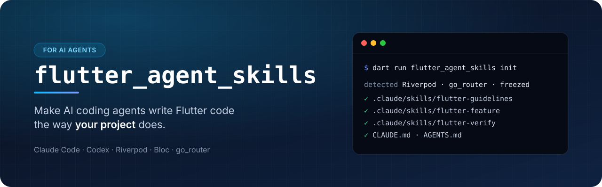

<div align="center">



<br>

[](https://pub.dev/packages/flutter_agent_skills)
[](https://pub.dev/packages/flutter_agent_skills/score)
[](https://github.com/Sujay-Dynamisch/Flutter-Agent-Skills/actions/workflows/dart.yml)
[](LICENSE)

**[Get started](#get-started)** &nbsp;·&nbsp; **[Skills](#skills)** &nbsp;·&nbsp; **[How it works](#how-it-works)** &nbsp;·&nbsp; **[Plugin](#claude-code-plugin)** &nbsp;·&nbsp; **[Roadmap](#roadmap)**

</div>

<br>

AI coding agents are fast, but they don't know your Flutter codebase. They add a second state-management library, hand-edit generated files, reformat files the task didn't touch, and report "done" before the analyzer passes.

**flutter_agent_skills** fixes that with one command. It reads your `pubspec.yaml`, detects your stack, and installs skills and project rules for **Claude Code** and **Codex**.

<table>
<tr>
<td width="33%" valign="top">

### Follows your architecture
Reuses your state management, routing and folder layout instead of inventing new ones.

</td>
<td width="33%" valign="top">

### Keeps diffs small
No unrequested dependencies, no edits to generated files, and no reformatting of files the task didn't touch.

</td>
<td width="33%" valign="top">

### Guards your dependencies
Blocks made-up package names and flags risky ones before the agent adds them.

</td>
</tr>
</table>

## Get started

```bash
dart pub add dev:flutter_agent_skills
dart run flutter_agent_skills init
```

That's the whole setup. Open the project in Claude Code or Codex and start building.

> [!TIP]
> Safe to re-run at any time. Your own content in `CLAUDE.md` and `AGENTS.md` is never touched.

<details>
<summary><b>Global install</b></summary>
<br>

```bash
dart pub global activate flutter_agent_skills
fas init
```

The `fas` shortcut needs the pub cache `bin` folder on your `PATH` (Windows: `%LOCALAPPDATA%\Pub\Cache\bin`). Without it, run `dart pub global run flutter_agent_skills init`.

</details>

<details>
<summary><b>CLI options</b></summary>
<br>

| Option | Description |
|---|---|
| `-t, --target` | Agents to configure: `claude`, `codex` (default: both) |
| `-d, --dir` | Project directory (default: current directory) |
| `--dry-run` | Preview changes without writing files |
| `--no-hooks` | Skip the dependency-guard hook in `.claude/settings.json` |
| `check <name>...` | Check packages on pub.dev (`--pubspec` checks all dependencies; exits 1 if any don't exist) |
| `list` | Print the bundled skills |
| `--version` | Print the installed version |

</details>

## Skills

| | Skill | What it does |
|:-:|---|---|
| **01** | `flutter-guidelines` | Core working rules: think before coding, simplicity first, surgical changes, goal-driven execution, tuned for Flutter. |
| **02** | `flutter-feature` | Builds features in your existing structure: model, data, state, UI, route and tests. Supports Riverpod, Bloc, Provider, GetX and `setState`. |
| **03** | `flutter-verify` | Runs code generation, formatting, analysis and tests in a loop until clean, then reports the real results. |

## Dependency guard

AI agents regularly suggest packages that don't exist, and attackers register those hallucinated names with malicious code ("slopsquatting"). `init` adds a Claude Code hook that checks every `flutter pub add` and `pubspec.yaml` edit against pub.dev **before it runs**.

| Finding | Result |
|---|---|
| Package doesn't exist on pub.dev | **Blocked**, and the agent is told to pick a real package |
| Discontinued, unlisted, published in the last 30 days, or unverified with low adoption | **You're asked** to confirm |
| Everything else | Runs normally |

```console
$ dart run flutter_agent_skills check dio flutter_magic_ai_sdk flutter_gemma
ok     dio
block  flutter_magic_ai_sdk: does not exist on pub.dev (possibly a hallucinated name)
warn   flutter_gemma: discontinued, replaced by flutter_edge_ai
```

Use `check --pubspec` in CI to audit all dependencies. If pub.dev can't be reached, the hook never blocks the agent.

## How it works

**1. Detect.** `init` reads `pubspec.yaml` and builds a profile of your stack.

```markdown
### Project profile (detected from pubspec.yaml)
- Package: `my_app` (Flutter app/package)
- State management: Riverpod
- Routing: go_router
- Code generation: build_runner, freezed, riverpod_generator
- Other key packages: Firebase, dio, mocktail
```

**2. Install.** It writes the skills and the profile where each agent looks for them.

| File | Read by |
|---|---|
| `.claude/skills/*/SKILL.md` | Claude Code |
| `CLAUDE.md` | Claude Code |
| `.claude/settings.json` | Claude Code (dependency-guard hook; other settings are kept) |
| `AGENTS.md` | Codex and other `AGENTS.md`-compatible agents |

**3. Build.** Your agent reads the profile and rules before every task, then follows the matching skill.

<details>
<summary><b>Supported packages</b></summary>
<br>

| Category | Packages |
|---|---|
| State management | Riverpod, Bloc, Provider, GetX, MobX, Signals |
| Routing | go_router, auto_route, beamer |
| Code generation | build_runner, freezed, json_serializable, riverpod_generator, injectable |
| Other | Firebase, dio, http, drift, isar, hive, get_it, mocktail, mockito, flutter_hooks |

</details>

## Claude Code plugin

Prefer plugins? Install the skills directly in Claude Code:

```text
/plugin marketplace add Sujay-Dynamisch/Flutter-Agent-Skills
/plugin install flutter-agent-skills@flutter-agent-skills
```

> [!NOTE]
> The plugin installs skills only. Run `init` to also add the project profile to `CLAUDE.md` and `AGENTS.md`.

## Programmatic use

```dart
import 'dart:io';

import 'package:flutter_agent_skills/flutter_agent_skills.dart';

void main() {
  final profile = ProjectProfile.fromPubspec(File('pubspec.yaml').readAsStringSync());
  print(profile.stateManagement); // [Riverpod]

  Installer(Directory.current, dryRun: true)
      .install({AgentTarget.claude})
      .forEach(print);
}
```

## Roadmap

- [x] Claude Code skills and `CLAUDE.md`
- [x] Codex support via `AGENTS.md`
- [x] Claude Code plugin marketplace
- [x] Dependency guard against hallucinated and risky packages
- [ ] Cursor rules and GitHub Copilot instructions
- [ ] Hooks for automatic formatting and analysis after edits
- [ ] Skills for golden tests, performance and accessibility audits
- [ ] Skills for Flutter version migrations and pub.dev releases
- [ ] Evaluation suite running each skill against sample apps

Have an idea? [Open an issue](https://github.com/Sujay-Dynamisch/Flutter-Agent-Skills/issues).

## Contributing

Skills live in [`skills/`](skills/) and the rules template in [`templates/`](templates/). After editing them:

```bash
dart run tool/bundle.dart   # regenerate bundled content
dart test
```

New skills should be concise, Flutter-specific and verifiable.

## Acknowledgements

`flutter-guidelines` is adapted from the [Karpathy guidelines](https://github.com/forrestchang/andrej-karpathy-skills) (MIT), based on [Andrej Karpathy's observations](https://x.com/karpathy/status/2015883857489522876) on common LLM coding pitfalls.

<div align="center">
<br>

MIT License · Built for the Flutter community

</div>
